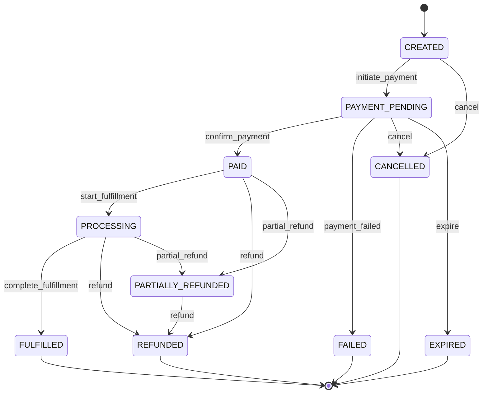

# Phase 1: Requirements Specification — StateFlow Engine

## 1. Executive Summary
StateFlow is a resilient, event-driven Order & Payment Lifecycle Engine. It guarantees that orders transition through valid business states with strict idempotency, auditability, and concurrency protection.

## 2. Domain States
The engine supports the following distinct lifecycle states:

| State | Category | Description |
| :--- | :--- | :--- |
| `CREATED` | Initial | Order draft created by customer with items and total amount. |
| `PAYMENT_PENDING` | Active | Customer initiated checkout; awaiting payment webhook or capture. |
| `PAID` | Active | Payment funds confirmed and held. |
| `PROCESSING` | Active | Order is being packed, provisioned, or prepared. |
| `FULFILLED` | Terminal | Order successfully delivered to customer. |
| `CANCELLED` | Terminal | Customer or admin cancelled order before capture. |
| `REFUNDED` | Terminal | Full refund — all funds returned to customer after payment. |
| `PARTIALLY_REFUNDED` | Active | Partial refund — some funds returned; remaining balance still active. |
| `FAILED` | Terminal | Payment declined or timeout occurred. |
| `EXPIRED` | Terminal | Order was not paid within the allowed window and was automatically expired. |

## 3. Allowed Transition Graph
Transitions outside of this matrix must be strictly rejected with HTTP 409 / Domain State Error.

## 4. Business Invariants & Acceptance Criteria
1. **Idempotency Guarantee**: Submitting the same payment confirmation event with an identical `idempotency_key` multiple times MUST NOT trigger duplicate transitions or double billing. It must safely return the existing order state.
2. **Deterministic Monetary Values**: Currency amounts must be stored as integer cents (e.g., $10.50 -> 1050 cents) to prevent floating-point inaccuracies.
3. **Optimistic Locking**: Every order contains an integer `version`. State update requests must match the current version, preventing race conditions.
4. **Immutable Audit Trail**: Every state mutation records:
   - `transition_id` (UUID)
   - `order_id` (UUID)
   - `from_state`
   - `to_state`
   - `reason` / `trigger`
   - `actor` (e.g., "customer", "payment_gateway", "admin")
   - `timestamp` (ISO 8601 UTC)
5. **No Escape from Terminal States**: Once in `FULFILLED`, `CANCELLED`, `REFUNDED`, `FAILED`, or `EXPIRED`, any further state mutation attempts must fail with `InvalidStateTransitionError`.
6. **Partial Refund Amount Validation**: A partial refund request includes `refund_amount_cents`. This value must be greater than 0 and less than or equal to the order's `amount_cents`. The `refunded_cents` field on the order tracks cumulative refunded amounts.
7. **Auto-Expiration**: Orders stuck in `PAYMENT_PENDING` for longer than a configurable timeout (default 30 minutes) may be expired via the `expire` trigger. The system provides a `/expire-stale` endpoint to batch-expire stale orders.
